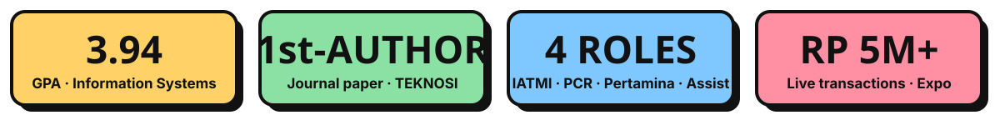

<picture>
  <source media="(prefers-color-scheme: dark)" srcset="assets/banner-dark.svg">
  
</picture>

  
  
  

### 👋 Hi, I'm Fadhil

I'm a **full-stack engineer from Riau, Indonesia** who likes owning a product from the first
requirements meeting to the production server. I build web systems, data dashboards and
ML-powered tools — usually as the only engineer on the project, so I care a lot about clean
architecture, documentation and handing over things that just keep working.

- 🛢️ Right now: **Full-stack Engineer @ IATMI** (Indonesian Petroleum Engineers Association) — React, Node.js, servers, mail and CI/CD, end to end
- 🎓 **Information Systems @ Politeknik Caltex Riau** — GPA 3.94 / 4.00
- 📄 First-author paper on a user-centered BI dashboard for higher-education quality assurance ([TEKNOSI 12(2)](https://doi.org/10.25077/TEKNOSI.v12i2.2026.377-385))
- 🤖 Daily driver: an AI-augmented workflow (Claude Code, Copilot) to ship multi-developer scope solo

<picture>
  <source media="(prefers-color-scheme: dark)" srcset="assets/stats-dark.svg">
  
</picture>

## 🚀 Featured projects

<table>
<tr>
<td width="50%" valign="top">

### 📊 [Statik](https://github.com/FadhilHere/statik)
A lightweight **SPSS-style statistics desktop app** in Rust for students: Data Editor,
regression with classical-assumption tests, t-tests, normality tests, and output tables
that paste straight into Word — in an **11 MB `.exe`**, verified against NIST certified values.

`Rust` `egui` `Statistics` `Desktop`

</td>
<td width="50%" valign="top">

### 🎓 [RPL-PCR](https://github.com/FadhilHere/RPL-PCR)
Production **academic recognition system** for Politeknik Caltex Riau with **5 user roles**,
each with its own dashboard and workflow. Sole developer from requirements to production at
[rpl.pcr.ac.id](https://rpl.pcr.ac.id).

`Laravel` `PHP` `Tailwind` `System Design`

</td>
</tr>
<tr>
<td width="50%" valign="top">

### 🛍️ [Expo Technopreneurship](https://github.com/FadhilHere/expo_techno)
Official platform of the PCR Technopreneurship Expo, **reused year over year** — used by
20+ tenant teams with **Rp 5M+ in live transactions**. Built and hosted on a VPS solo.

`Laravel` `Vue.js` `Tailwind` `VPS`

</td>
<td width="50%" valign="top">

### 🐦 [Danantara Sentiment Analysis](https://github.com/FadhilHere/sentimen-analisis-danantara-X)
Sentiment analysis of **58,893 tweets** about Indonesia's Danantara fund. SVM vs Naive Bayes
with GridSearchCV tuning, served through a Streamlit app.

`Python` `scikit-learn` `NLP` `Streamlit`

</td>
</tr>
<tr>
<td width="50%" valign="top">

### ✨ [Portfolio](https://github.com/FadhilHere/portofolio)
Motion-graphic resume site in **pastel neo-brutalism**: GSAP ScrollTrigger, SplitText, Flip,
Lenis smooth scroll and an interactive isometric hero. → [fadhilparmata.vercel.app](https://fadhilparmata.vercel.app)

`React` `TypeScript` `GSAP` `Vite`

</td>
<td width="50%" valign="top">

### 🗺️ [MoJalan](https://github.com/FadhilHere/MoJalan)
Marketplace connecting tourists with **local tour guides** — full UI/UX designed in Figma,
then implemented natively on Android.

`Kotlin` `Android` `Figma` `UI/UX`

</td>
</tr>
</table>

## 💼 Experience

| When | Where | What I did |
|---|---|---|
| **Jul 2026 — now** | **IATMI** · Full-stack Engineer | Only engineer for the association's web systems: React front end, Node.js/Express back end, web & mail servers, CI/CD. Redesigned the UX of the Simposium IATMI XVIII 2026 website. |
| **Mar — Jun 2026** | **Politeknik Caltex Riau** · Software Engineer | Architected and shipped a 5-role academic recognition system solo, from requirements to production at rpl.pcr.ac.id. |
| **Oct 2024 — Jan 2025** | **Pertamina RU II Dumai** · Software Engineer Intern | Built the IT Internship Management System in ASP.NET Core 8 on Pertamina's clean-architecture template; 100% of intern intake digitised, zero support tickets after hand-over. |
| **Jul — Nov 2021** | **Assist.id** · Backend Engineer Intern | REST API on the MERN stack for a hospital-management SaaS mobile app. |

## 🧰 Toolbox

  

  
  
  
  
  
  

## 🏆 Highlights

- 📄 **First-author journal publication** — *Development of a User-Centered Business Intelligence Dashboard to Support the PPEPP Quality Assurance Framework in Higher Education*, TEKNOSI 12(2), 377–385 (2026). SUS score raised from 78.7 to 83.72 over three design iterations.
- 🏅 **Beasiswa Prestasi Pemerintah Provinsi Riau** — merit scholarship (2023)
- 💻 **Hackfest 2024** — Google Developer Student Club hackathon on the SDGs
- 🧑‍🏫 **Head of Research & Technology**, HIMASISTIFO (2023–2025) — led the department and sat on the steering committee of HI-TECH 7, a national student tech competition

## 🐍 Contributions

<picture>
  <source media="(prefers-color-scheme: dark)" srcset="https://raw.githubusercontent.com/FadhilHere/FadhilHere/output/github-snake-dark.svg">
  
</picture>

Want to build something together? Say hi on <a href="https://www.linkedin.com/in/fadhil-parmata-2599a0310">LinkedIn</a> or check out <a href="https://fadhilparmata.vercel.app">my portfolio</a>.

